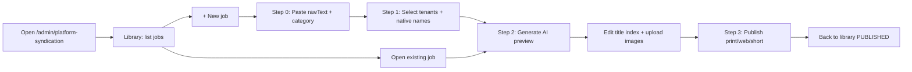
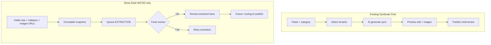

# News Desk Frontend Flow Analysis (W0–W2)

**Date:** 2026-11-20  
**Scope:** Analysis only — no code changes in this task.  
**Repos inspected:** `admin.kaburlu` (Next.js admin), `kaburlu_media_backend` (API + Prisma).  
**Backend reference:** [NEWS_DESK_FRONTEND_API_INTEGRATION.md](/Volumes/Storage/kaburlu_softwares/kaburlu_media_backend/docs/architecture/NEWS_DESK_FRONTEND_API_INTEGRATION.md)

---

## 1. Existing Syndicate Post frontend architecture

### 1.1 Routing & shell

| Item | Implementation |
|------|----------------|
| Public route | `/admin/platform-syndication` → `pages/admin/platform-syndication.js` |
| Layout | `DashboardLayout` (title: “Platform Syndication”) |
| Platform desk home | `PLATFORM_DESK_HOME = '/admin/platform-syndication'` (`lib/platformDesk.js`) |
| Nav | `dashboardNavConfig.js` → key `platform-syndication`; platform-desk users get reduced nav via `PLATFORM_DESK_ROUTES` |

### 1.2 Component tree

```
PlatformSyndicationPage
└── SyndicationView
    ├── mode === 'library' → job list + status filters
    └── mode === 'compose'  → SyndicationDesk (create/edit job)
        ├── SyndicationStepper (4 steps)
        ├── SyndicationAiLoader (overlay during generate)
        ├── SyndicationImageSection + SyndicationImageCropModal
        └── Fixed footer: Back / Continue / Publish
```

### 1.3 Frontend service layer

**File:** `lib/api/services/syndicationApi.js`  
**Base path:** `/api/v1/platform/syndication` (via `apiClient` + JWT from `utils/auth`)

| Method | Client function | Notes |
|--------|-----------------|-------|
| POST | `previewSource` | **Defined but not used in UI** |
| POST | `generate` | **Defined but not used in UI** (desk uses create + generateJob) |
| POST | `createJob` | ✅ |
| POST | `generateJob` | ✅ |
| PATCH | `patchJob` | ✅ |
| POST | `publishJob` | ✅ |
| GET | `listJobs` | ✅ (returns **unwrapped** `apiClient` response — not `unwrapSyndicationResponse`) |
| GET | `getJob` | ✅ |
| DELETE | `deleteJob` | **Defined but not used in UI** |
| GET pipeline/facts/retry | — | **Not implemented in client** |

**Helpers:** `lib/syndication/apiResponse.js`, `lib/syndication/publishPrep.js`, `lib/syndication/imageCrop.js`, `lib/syndication/platformRoles.js`

**Types:** Admin app is **JavaScript only** — no TypeScript interfaces; shapes are implicit from API responses and inline usage.

### 1.4 Permissions (frontend)

| Check | Location | Roles allowed |
|-------|----------|----------------|
| `canAccessSyndication(user)` | `lib/syndication/platformRoles.js` | `SUPER_ADMIN`, `SUPERADMIN`, `ADMIN`, `NEWS_MODERATOR`, `NEWS_DESK`, `NEWS_DESK_ADMIN`, `DESK_EDITOR`, `DESKEDITOR`, `NEWSDESK` |
| Backend desk routes | `requireSyndicationDeskRole` | `SUPER_ADMIN`, `SUPERADMIN`, `NEWS_MODERATOR`, `NEWS_DESK`, `NEWS_DESK_ADMIN` only |

Frontend is **wider** than backend desk API (e.g. `ADMIN` in frontend list may get 403 on API).

### 1.5 Form fields & validation (actual UI)

| Area | Fields | Validation / behavior |
|------|--------|------------------------|
| Step 0 — Raw news | `rawText` (textarea), `selectedCategoryId`, optional `rawTime`, `postTime` | `canNext`: rawText + category; 5W gate on **generate** (422 + `missingElements`) |
| Step 1 — Tenants | Multi-select chips, per-tenant `nativeName` | **Requires ≥1 tenant** before generate/save |
| Step 2 — Review | Category re-select, **Generate AI preview**, Save draft, alternate title index, read-only previews, images | Client `validateGeneratedJob` after generate; images required before publish step |
| Step 3 — Publish | Short news checkbox, domain warnings, publish result | Requires `masterPrint.body`, cover image, no stale tenant list |

**Not in UI (but API supports):** `sourceUrl`, `sourceAttribution`, `previewSource`, `DELETE` job, dedicated `headline` field (only `rawText` paste).

### 1.6 Images

- Shown on **Review** step (after generate), not on intake step.
- Upload via `articleService.uploadMedia` → folder `syndication` (not a syndication-specific upload endpoint).
- Crop: `SyndicationImageCropModal` (16:9, 3:2, dual portrait).
- Payload: `{ images: { sharedImageUrl, tenantImages: { [tenantId]: url } } }`.

### 1.7 AI generate & publish

- **Generate:** `PATCH` job with full payload → `POST /jobs/:id/generate` (sync; blocks with 422 if 5W missing).
- **Publish:** `PATCH` (publish prep) → `POST /jobs/:id/publish` with `selectedTitleIndex`, `publishShortNews`, `shortNewsTenantId`, `tenantDomainMap`.
- **Short news:** optional Kaburlu Today tenant (`NEXT_PUBLIC_SHORT_NEWS_TENANT_ID`).

### 1.8 Job list

- Filters: `SyndicationJobStatus` only — `DRAFT`, `PREVIEW_READY`, `PUBLISHED` (+ “All”).
- Card title: `masterPrint.headline` || category name.
- Click row → `compose` mode with `activeJobId`.

### 1.9 Loading / errors

- `toast` for success/error; `SyndicationApiError` with `status`, `data.code`, `missingElements` on 422.
- Partial publish: `status === 'PARTIAL'` with per-tenant error list.
- `aiLoading` + `SyndicationAiLoader` during generate.

---

## 2. Existing user journey (Syndicate Post)



---

## 3. Complete API mapping (frontend action → backend)

| # | Frontend action | HTTP | Path | Request (summary) | Response (summary) | Auth |
|---|-----------------|------|------|-----------------|-------------------|------|
| 1 | Load tenants | GET | `/tenants?full=true` | — | Tenant list | JWT |
| 2 | Load categories | GET | `/categories` | `languageId` / `languageCode` | Categories | JWT |
| 3 | Load tenant domains | GET | `/tenants/:id/domains` | — | Domains | JWT |
| 4 | Upload image | POST | (article media upload) | multipart | `{ url }` | JWT |
| 5 | List jobs | GET | `/platform/syndication/jobs` | `status`, `page`, `pageSize` | `{ success, total, items[] }` | JWT + desk role |
| 6 | Get job | GET | `/platform/syndication/jobs/:id` | — | `{ success, job }` (+ `pipeline` if V2) | JWT + desk |
| 7 | Create draft | POST | `/platform/syndication/jobs` | see §3.1 | `{ success, job, status? }` | JWT + desk |
| 8 | Patch job | PATCH | `/platform/syndication/jobs/:id` | images, tenants, titles… | `{ success, job }` | JWT + desk |
| 9 | Generate AI | POST | `/platform/syndication/jobs/:id/generate` | `{}` | `{ success, job }` or 422 blocked | JWT + desk |
| 10 | Publish | POST | `/platform/syndication/jobs/:id/publish` | `selectedTitleIndex`, maps… | `{ success, status, published, errors }` | JWT + desk |
| 11 | Source preview | POST | `/platform/syndication/source-preview` | `{ sourceUrl }` | preview object | JWT + desk (**unused in UI**) |
| 12 | Delete job | DELETE | `/platform/syndication/jobs/:id` | — | `{ success }` | JWT + desk (**unused in UI**) |

### 3.1 Legacy create/generate payload (from `SyndicationDesk.buildPayload`)

```json
{
  "rawText": "string",
  "category": { "categoryId": "..." } | { "categoryName": "..." },
  "rawTime": "optional",
  "postTime": "optional",
  "images": {
    "sharedImageUrl": "https://...",
    "tenantImages": { "tenantId": "https://..." }
  },
  "tenants": [{ "tenantId": "...", "nativeName": "..." }],
  "options": {
    "shortNewsTenantId": "...",
    "alternateTitlesCount": 10,
    "languageCode": "te",
    "showSourceLinkOnWeb": false,
    "categoryNames": ["..."],
    "model": "5.2",
    "temperature": 0.2
  }
}
```

### 3.2 Backend stack (legacy path)

| Layer | Location |
|-------|----------|
| Routes | `src/api/platformSyndication/platformSyndication.routes.ts` |
| Service | `src/lib/platformSyndication/syndication.service.ts` |
| Validation | `src/lib/platformSyndication/syndication.validation.ts` |
| AI generate | `syndication.service` → newsroom rewrite pipeline |
| Publish | `publishSyndicationJob` → print/web/unified post |
| DB | `SyndicationJob`, `SyndicationJobTenant`, `Category`, `Tenant`, … |

### 3.3 Error shape (syndication)

```json
{ "success": false, "code": "RAW_TEXT_REQUIRED", "error": "message" }
{ "success": false, "status": "INSUFFICIENT_DATA_ALERT", "missingElements": ["WHO", ...] }
```

---

## 4. News Desk W0–W2 vs existing Syndicate flow

### 4.1 What W0–W2 actually implements (verified)

| Capability | Status |
|------------|--------|
| V2 intake on `POST /jobs` with `options.newsDeskPipelineV2: true` + env `NEWS_DESK_PIPELINE_V2=true` | ✅ |
| `NewsDeskRawSnapshot` (immutable at intake) | ✅ DB; **not fully exposed on GET** |
| `NewsDeskPipeline` + queue `EXTRACTION` | ✅ |
| `GET .../pipeline`, `GET .../facts`, `POST .../retry-extraction` | ✅ |
| Legacy `generate` / `publish` blocked when pipeline exists | ✅ `assertLegacyGenerateAllowedForJob` |
| Tenant list **not** required on V2 create | ✅ |
| Multiple image URLs (array) | ✅ |
| Dedicated syndication image upload API | ❌ |
| List filter by extraction status | ❌ |
| Search headline | ❌ |
| GET immutable snapshot body separate from mutable `job.rawText` | ❌ |
| GET `locationHint` | ❌ |
| GET audit log | ❌ |
| Global admin queue monitor API | ❌ |
| Duplicate / location / routing / tenant AI / editorial | ❌ (schema only) |

### 4.2 Frontend gap

**Zero News Desk V2 UI or API client methods** in `admin.kaburlu` today. Existing page is **100% legacy** syndication.

### 4.3 Flow comparison



**W0–W2 UI must stop at facts review** — no publish, no tenant multi-select as a gate, no “Generate AI preview” button for V2 jobs.

---

## 5. Proposed News Desk frontend user journey (W0–W2)

1. **Intake** — Headline (optional), article body (`rawText`), category, source URL/attribution (optional), multiple image URLs (upload via existing media service), optional `locationHint` (stored; not readable via GET in W2).
2. **Submit** — `POST /jobs` with `options.newsDeskPipelineV2: true`, `tenants: []` or omitted.
3. **Detail** — Show `jobId`, poll `GET /facts` + `GET /pipeline`.
4. **States** — Badges: `EXTRACTION_PENDING`, `EXTRACTION_SUCCEEDED`, `EXTRACTION_FAILED`.
5. **Facts review** — Render `facts` object (read-only); show `missingInformation`, `failure.message`.
6. **Retry** — Button when allowed → `POST .../retry-extraction` → resume poll.
7. **Do not show** — Generate, publish, alternate headlines, per-tenant web preview, short news (those are legacy or W3+).

### 5.1 Component reuse plan

| Component / module | Reuse for News Desk? | Notes |
|--------------------|----------------------|-------|
| `DashboardLayout`, nav, `canAccessSyndication` | ✅ | Same RBAC family |
| `SyndicationStepper` | ⚠️ Partial | Replace steps: Intake → Processing → Facts (not 4-step publish) |
| `SyndicationDesk` | ❌ Do not extend | Tightly coupled to legacy generate/publish; risk of regression |
| Category loading logic from `SyndicationDesk` | ✅ Extract shared hook later | `loadCategories`, `mergeCategoryOptions` |
| `SyndicationImageSection` | ✅ Adapt | Support multiple shared URLs (V2 array); move upload earlier (intake) |
| `SyndicationImageCropModal` | ✅ | Same CDN upload path |
| `syndicationApi` | ✅ Extend **new file** e.g. `newsDeskApi.js` | Add pipeline/facts/retry; keep legacy methods unchanged |
| `SyndicationView` list | ⚠️ | New filters need N+1 `facts` calls or new backend APIs |
| `toast`, `Button`, `FormField`, `Spinner` | ✅ | UI kit |

### 5.2 Admin panel journey (W2)

Same routes as desk users (no separate admin API). Proposed **filters as client-side** until backend list supports pipeline status:

| View | Data source |
|------|-------------|
| All submissions | `GET /jobs` |
| Extraction pending | Client: `GET /facts` where `extractionStatus === EXTRACTION_PENDING` |
| Processing | `failure.queueStatus === LOCKED` |
| Completed | `EXTRACTION_SUCCEEDED` |
| Failed | `EXTRACTION_FAILED` / `DEAD` |
| Facts detail | `GET /facts` |
| Retry | `POST retry-extraction` |
| Audit history | **No API** — omit or show “not available” |

Super Admin full dashboard may add nav item **News Desk** distinct from **Platform Syndication**.

---

## 6. Existing vs missing APIs (frontend actions)

| Frontend action | Existing API | Missing / gap | Backend change required? |
|-----------------|-------------|---------------|------------------------|
| 1. Submit News Desk news | `POST /jobs` + V2 flags | Env flag must be on in prod | Ops only |
| 2. Upload multiple images | `articleService.uploadMedia` | No syndication-native upload | **NOT REQUIRED** (URLs only) |
| 3. List submissions | `GET /jobs` | No pipeline fields in list | Optional: embed `pipelineStatus` in list (**NOT IMPLEMENTED**) |
| 4. Filter by extraction status | — | **NOT IMPLEMENTED** | **Proposed** `?pipelineStatus=` on list (**NOT IMPLEMENTED**) |
| 5. Search news | — | **NOT IMPLEMENTED** | **Proposed** `?search=` on list (**NOT IMPLEMENTED**) |
| 6. View complete original snapshot | `GET /jobs` → `rawText` only | Immutable snapshot GET | **Proposed** `GET .../snapshot` (**NOT IMPLEMENTED**) |
| 7. View pipeline status | `GET .../pipeline` | ✅ | No |
| 8. View extracted facts | `GET .../facts` | ✅ | No |
| 9. Retry failed extraction | `POST .../retry-extraction` | ✅ | No |
| 10. Extraction audit history | — | **NOT IMPLEMENTED** | **Proposed** `GET .../audit` (**NOT IMPLEMENTED**) |
| 11. Admin global queue monitor | — | **NOT IMPLEMENTED** | **Proposed** `GET /platform/news-desk/queues` (**NOT IMPLEMENTED**) |
| 12. Delete/cancel submission | `DELETE /jobs/:id` | ✅ (not in UI today) | No — wire UI only |

---

## 7. Proposed backend API contracts (NOT IMPLEMENTED)

### 7.1 List jobs with pipeline filter

**Proposed:** `GET /platform/syndication/jobs?pipelineStatus=EXTRACTION_PENDING&search= headline snippet`

**Response:** extend each item with `pipeline?: { status, extractionStatus }`.

**RBAC:** same as `GET /jobs`.  
**Prisma:** query join `NewsDeskPipeline` — no new model.

### 7.2 Read-only immutable snapshot

**Proposed:** `GET /platform/syndication/jobs/:id/snapshot`

```json
{
  "success": true,
  "headline": "string|null",
  "articleText": "string",
  "categoryId": "string|null",
  "imageRefs": { "urls": [], "mediaIds": [] },
  "sourceUrl": "string|null",
  "sourceAttribution": {},
  "locationHint": {},
  "acceptedAt": "ISO-8601"
}
```

**RBAC:** `requireSyndicationDeskRole`.  
**Validation:** 404 if no pipeline. Read `NewsDeskRawSnapshot` only.

### 7.3 Audit log (optional W2.5)

**Proposed:** `GET /platform/syndication/jobs/:id/audit?limit=50`

**Response:** array from `NewsDeskAuditLog`.  
**RBAC:** desk roles. No new model.

### 7.4 Global queue monitor (optional)

**Proposed:** `GET /platform/news-desk/queues?page=&pageSize=&status=PENDING`

**Response:** paginated `NewsDeskJobQueue` rows (no `pipelineId` PII in list).  
**RBAC:** `SUPER_ADMIN` / `NEWS_DESK_ADMIN` only (**NOT IMPLEMENTED** — product decision).

---

## 8. RBAC summary

| Role (backend desk) | Submit | List | Pipeline/Facts | Retry | Delete | Legacy generate/publish |
|---------------------|--------|------|----------------|-------|--------|-------------------------|
| NEWS_DESK, NEWS_MODERATOR, NEWS_DESK_ADMIN, SUPER_ADMIN | ✅ | ✅ | ✅ | ✅ | ✅ | ✅ on **non-V2** jobs only |
| Platform role without desk | ❌ | ❌ | ❌ | ❌ | ❌ | ❌ |
| `GET /web-articles` | — | ✅ platform family | — | — | — | — |

Frontend should align `canAccessSyndication` with backend desk roles before News Desk launch (optional tighten).

---

## 9. Implementation phases (recommended)

| Phase | Goal | Frontend | Backend |
|-------|------|----------|---------|
| **P0** | No regression | Leave `/admin/platform-syndication` unchanged | Already deployed W0–W2 |
| **P1** | News Desk intake + detail | New page + `newsDeskApi` (pipeline, facts, retry) | Use existing endpoints only |
| **P2** | List UX | Tabs/filters with client-side `facts` enrichment | Optional list API enhancement |
| **P3** | Snapshot fidelity | Show “immutable original” | Optional `GET /snapshot` |
| **P4+** | W3+ | Hide until APIs exist | Duplicate, location, routing, generate, publish |

---

## 10. Files involved (exact paths)

### Frontend (existing — legacy Syndicate)

| File | Role |
|------|------|
| `pages/admin/platform-syndication.js` | Route entry |
| `components/dashboard/syndication/SyndicationView.jsx` | List + compose toggle |
| `components/dashboard/syndication/SyndicationDesk.jsx` | 4-step workflow |
| `components/dashboard/syndication/SyndicationStepper.jsx` | Step UI |
| `components/dashboard/syndication/SyndicationAiLoader.jsx` | Generate overlay |
| `components/dashboard/syndication/SyndicationImageSection.jsx` | Image upload/crop |
| `components/dashboard/syndication/SyndicationImageCropModal.jsx` | Cropper |
| `lib/api/services/syndicationApi.js` | API client |
| `lib/syndication/apiResponse.js` | Unwrap + validate job |
| `lib/syndication/publishPrep.js` | Publish PATCH builder |
| `lib/syndication/platformRoles.js` | Access gate |
| `lib/platformDesk.js` | Desk shell routes |
| `components/dashboard/dashboardNavConfig.js` | Nav entry |

### Frontend (proposed — News Desk W0–W2, not built)

| File | Role |
|------|------|
| `pages/admin/news-desk.js` (proposed) | New route |
| `components/dashboard/newsDesk/*` (proposed) | Intake, detail, facts panel |
| `lib/api/services/newsDeskApi.js` (proposed) | pipeline, facts, retry |

### Backend (implemented)

| File | Role |
|------|------|
| `src/api/platformSyndication/platformSyndication.routes.ts` | HTTP |
| `src/lib/platformSyndication/syndication.service.ts` | Jobs CRUD, legacy AI |
| `src/lib/newsDeskPipeline/**` | Intake, queue, extraction |
| `src/lib/newsDeskPipeline/extraction/getFactsByJobId.ts` | Facts API |
| `src/lib/newsDeskPipeline/extraction/manualRetryExtraction.ts` | Retry |
| `prisma/schema.prisma` | `SyndicationJob`, `NewsDeskPipeline`, … |

---

## 11. Recommendation: separate page vs V2 mode on same page

### Recommendation: **Separate page** (`/admin/news-desk`), reusing selected components — **do not** add a “V2 mode” to `SyndicationDesk`.

**Reasoning from the actual codebase:**

1. **Different mandatory path** — Legacy `SyndicationDesk` requires tenants before generate (`onGenerate` checks `selectedTenantIds.length`); V2 intake explicitly allows empty tenants. A mode flag inside the same stepper will invite accidental legacy calls on V2 jobs.

2. **Blocked operations** — Backend blocks `POST .../generate` and `.../publish` when `NewsDeskPipeline` exists. The current UI always surfaces Generate/Publish buttons in steps 2–3; hiding them behind a mode is error-prone and already caused backend guardrails.

3. **Different terminal state** — Legacy ends at `PUBLISHED` with `masterPrint` / `alternateTitles`. W2 ends at `EXTRACTION_SUCCEEDED` + facts JSON — showing empty “AI preview” panels would confuse editors.

4. **List filters** — Job library uses `SyndicationJobStatus` only; V2 jobs stay `DRAFT` while extraction runs. Mixing both in one list without pipeline badges will look “stuck” unless list UX is redesigned anyway.

5. **Regression risk** — `SyndicationDesk.jsx` is ~1050 lines with intertwined publish prep, stale-tenant detection, and short-news logic. News Desk should not extend that file.

6. **Safe reuse** — Image upload/crop, category fetching, `syndicationApi.createJob` with different `options`, shared layout/permissions, and polling utilities can be shared via **new** thin modules without touching legacy compose flow.

**Optional UX:** Keep one nav group “Desk” with two links: **Syndicate Post (publish)** vs **News Desk (intake & facts)** — same roles, different routes.

---

## 12. Approval gate

No implementation has been performed for this document. Await product approval on:

- Separate route name (`/admin/news-desk` vs tab on syndication page)
- Whether P2 waits for backend list filters or ships client-side N+1 polling
- Whether to expose `DELETE` on News Desk submissions in v1

---

*Generated from source inspection. Legacy Syndicate Post behavior preserved in documentation only; no application code was modified in this task.*